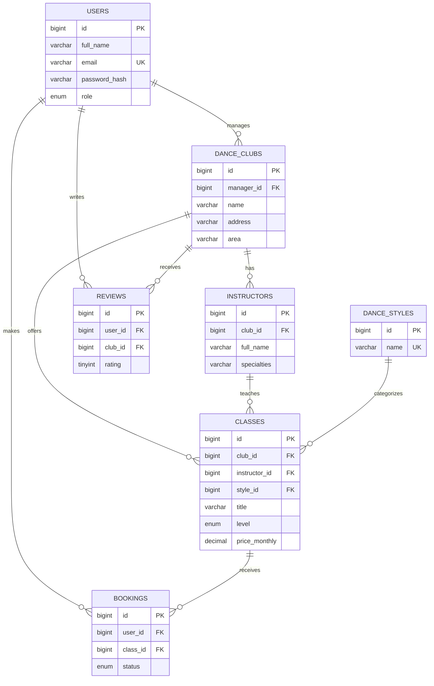

# Sarajevo DanceHub — Draft ERD (Milestone 1)

## Relationship notes
- One user can manage multiple clubs (or none).
- One club has many instructors and classes.
- One instructor can teach many classes; each class references one instructor.
- Each class belongs to one dance style.
- Users can book many classes; each booking links one user to one class.
- Users can review clubs; each review belongs to one user and one club.
- `users.role` is planned for role-based access. Managers must only manage clubs associated with their account.
